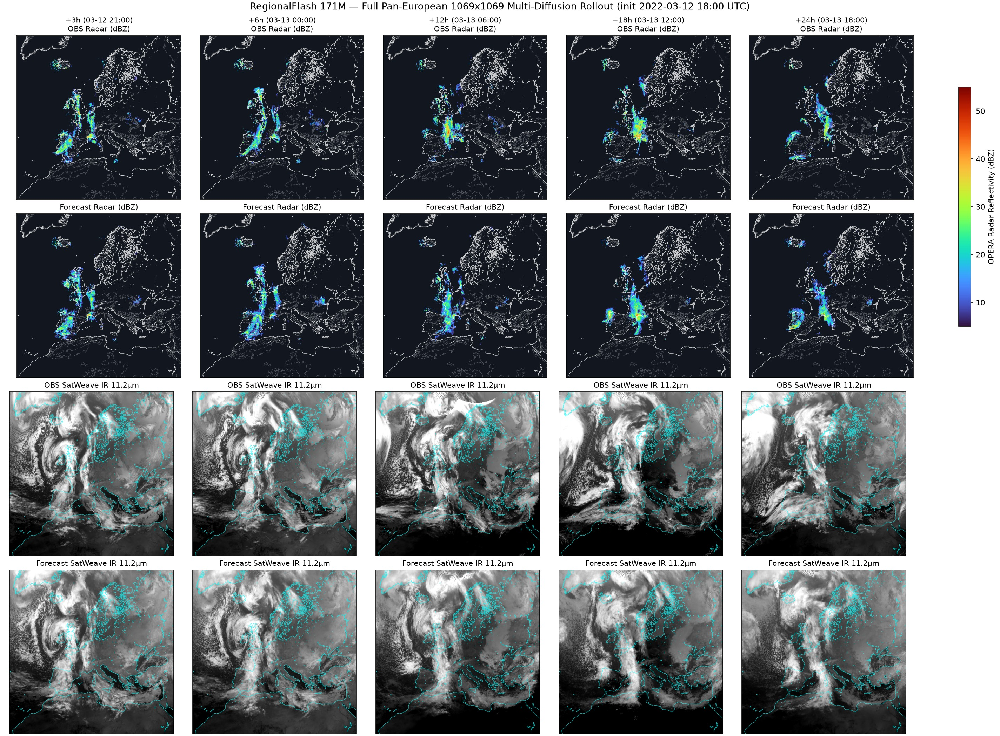
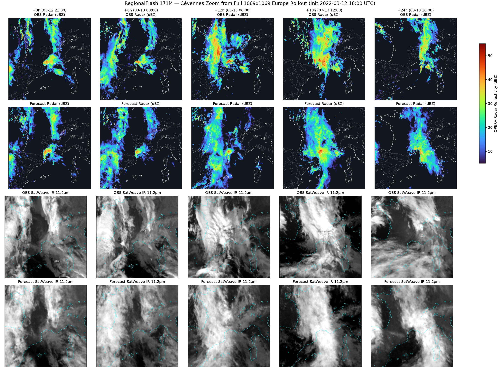

# RegionalFlash

**5.5 km** pan-European regional AI weather forecasting dataset and **2-frame JiT-3D DiT (x-prediction Rectified Flow)** pipeline fusing **CERRA 3D Reanalysis (`t`) + Google SatWeave (`t+2h`) + EUMETNET OPERA Radar (`t+2h`) + European METAR Airports (`t+2h`) + ESA WorldCover 2021 (`landcover_5km.zarr`)**.

- **Hugging Face Model:** [`meteolibre-dev/regionalflash`](https://huggingface.co/meteolibre-dev/regionalflash)
- **Hugging Face Dataset:** [`meteolibre-dev/regionalflash`](https://huggingface.co/datasets/meteolibre-dev/regionalflash)

---

## Sample Forecast: 24h Pan-European Épisode Cévenol (`1069 × 1069`)

Autoregressive 24-hour multi-diffusion rollout (`2022-03-12 18:00 → 03-13 18:00 UTC`, unseen validation event) from the **`v2-256`** (`175.78M`) checkpoint using overlapping `256 × 256` tiles (`stride=192`, 20-step ODE, 1 ensemble member — **53 seconds** for all of Europe on 1× H200):



### Cévennes / Southern France Zoom
At the `+18h` peak of the event (`2022-03-13 12:00 UTC`), the model achieves **`CSI20 = 0.77`** and **`50.6 dBZ`** peak reflectivity (vs `52.4 dBZ` observed) with seamless tile boundaries across both OPERA Radar and SatWeave IR `11.2μm`:



---

## 1. Architecture (`RegionalFlashJiT3D`)
* **Core DiT Trunk (`regionalflash/model.py`):** `175.78M` params (`dim=1024, depth=12, heads=16, patch=(1, 8, 8)`), physics-structured `AtmosphericPatchEmbed` (3D vertical `Conv3d` + FiLM & cross-channel attention pooling), input-only ESA WorldCover `LandCoverEmbed` (`7` ch), `RMSNorm`, `SwiGLU`, `QK-Norm`, `3D Axial RoPE`, canonical **Low-rank AdaLN-Zero**, and **full bidirectional FlashAttention** across `T = 2` frames (frame 0 known context, frame 1 noisy target).
* **Dual Output Heads:**
  * `head_grid` (`69` ch): dense `CERRA(57)` + `SatWeave(11)` + `OPERA Radar dbzh(1)`
  * `head_metar` (`6` ch): dedicated 2D conv-refined airport head (`tmpc, dwpc, mslp_anom_hpa, u10, v10, p01m`)
* **JiT x-Prediction Rectified Flow (`regionalflash/flow.py`):**
  * Linear flow `x_t = (1 - t) x_0 + t eps`, stratified 32-bin `t`, clamped `1 / (t + 0.01)^2` x-loss weighting
  * Residual targets on CERRA + slow METAR vars (`tmpc, dwpc, mslp_anom_hpa`); absolute targets on Sat/Radar/wind/precip
  * FastNet inverse 3h-tendency variance channel weights (`norm_stats.json`), masked sat/radar/station-count-weighted METAR losses, and METAR context dropout (`0.15`)
  * Full-Europe overlapping **Tiled Diffusion** sampler (`sample_tiled_europe`) with raised-cosine blending and on-manifold sensor forcing at every denoising step.

---

## 2. Quickstart: Train Directly from Hugging Face

```bash
uv sync --extra train

# Train on a GPU machine (auto-downloads selected half-year periods + radar + METAR + static from HF)
uv run python -m regionalflash.train \
  --hf-download \
  --hf-periods 2018_H1 2018_H2 2019_H1 2019_H2 2020_H1 2020_H2 2021_H1 2021_H2 2022_H1 \
  --data-dir data/hf_cache \
  --epochs 30 \
  --batch-size 32 \
  --train-samples-per-epoch 16384 \
  --compile \
  --out-dir runs/jit3d_v1
```
